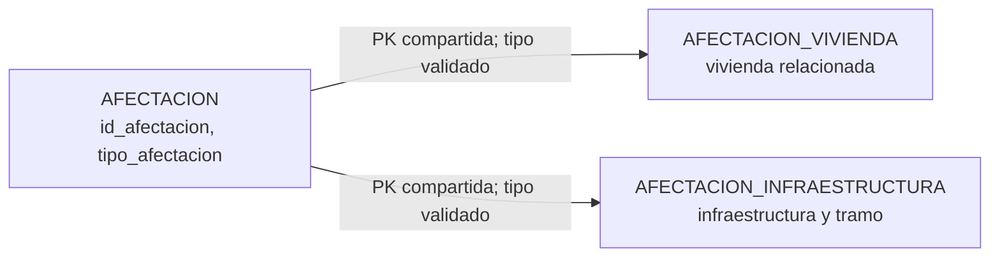

# Modelo entidad-relación (MER y MER extendido)

## Alcance y convenciones

El diseño se ajusta al esquema entregado por el compañero y contiene 36 entidades funcionales y dos tablas técnicas de seguridad (`usuario_app` y `admin_bootstrap_state`), para un total de **38 tablas**. Estas tablas técnicas no forman parte del dominio del MER. Los identificadores independientes usan `BIGINT IDENTITY`; las asociaciones y especializaciones comparten claves cuando la relación lo requiere. Las relaciones temporales de hogar, vivienda, habitación, propiedad y albergue conservan fechas para distinguir cambios entre eventos.

En el diagrama, `||` representa uno obligatorio, `o|` cero o uno y `o{` cero o muchos. Los enlaces se derivan de las claves foráneas del script de creación.

El diagrama relacional recibido del compañero se conserva como referencia visual en [`diagrama_relacional_base.pdf`](diagrama_relacional_base.pdf). El MER de esta entrega corresponde a la versión integrada que implementan los scripts y la aplicación.

## MER conceptual

```mermaid
erDiagram
    PERSONA ||--o{ AFECTACION_PERSONA : "persona id persona"
    REPORTE_DANO o|--o{ AFECTACION : "reporte dano id reporte"
    TERREMOTO ||--o{ AFECTACION : "terremoto id terremoto"
    TERREMOTO_MUNICIPIO ||--o{ CENSO : "id municipio"
    SECTOR ||--o{ EDIFICACION : "sector id sector"
    HOGAR o|--o{ ESTANCIA_ALOJAMIENTO : "hogar id hogar"
    INSPECCION o|--o{ EVIDENCIA : "inspeccion id inspeccion"
    REPORTE_DANO o|--o{ EVIDENCIA : "reporte dano id reporte"
    AFECTACION ||--o| AFECTACION_INFRAESTRUCTURA : "id afectacion"
    INFRAESTRUCTURA ||--o| AFECTACION_INFRAESTRUCTURA : "id infraestructura"
    TRAMO_INFRAESTRUCTURA ||--o| AFECTACION_INFRAESTRUCTURA : "tramo infraestructura id tramo"
    MUNICIPIO o|--o{ AFECTACION_PERSONA : "municipio id municipio"
    TERREMOTO ||--o{ AFECTACION_PERSONA : "terremoto id terremoto"
    AFECTACION ||--o| AFECTACION_VIVIENDA : "id afectacion"
    VIVIENDA ||--o| AFECTACION_VIVIENDA : "vivienda id vivienda"
    MUNICIPIO ||--o{ ALOJAMIENTO_TEMPORAL : "municipio id municipio"
    AFECTACION ||--o{ CONSECUENCIA_AFECTACION : "afectacion id afectacion"
    ALOJAMIENTO_TEMPORAL ||--o{ ESTANCIA_ALOJAMIENTO : "id alojamiento"
    PERSONA o|--o{ ESTANCIA_ALOJAMIENTO : "persona id persona"
    TERREMOTO ||--o{ ESTANCIA_ALOJAMIENTO : "terremoto id terremoto"
    INFRAESTRUCTURA ||--o{ INFRAESTRUCTURA_MUNICIPIO : "id infraestructura"
    MUNICIPIO ||--o{ INFRAESTRUCTURA_MUNICIPIO : "municipio id municipio"
    SOLICITUD_ATENCION ||--o{ INTERVENCION : "id solicitud"
    INTERVENCION ||--o{ INTERVENCION_ORGANIZACION : "intervencion id intervencion"
    ORGANIZACION ||--o{ INTERVENCION_ORGANIZACION : "organizacion id organizacion"
    HABITACION ||--o{ OCUPACION_HABITACION : "habitacion id habitacion"
    PERSONA ||--o{ REGISTRO_CENSAL_PERSONA : "persona id persona"
    VISITA_CENSO ||--o{ REGISTRO_CENSAL_PERSONA : "visita censo id visita"
    NECESIDAD ||--o{ SOLICITUD_ATENCION : "necesidad id necesidad"
    MUNICIPIO ||--o{ TERREMOTO_MUNICIPIO : "municipio id municipio"
    TERREMOTO ||--o{ TERREMOTO_MUNICIPIO : "terremoto id terremoto"
    INFRAESTRUCTURA ||--o{ TRAMO_INFRAESTRUCTURA : "id infraestructura"
    VIVIENDA ||--o{ HABITACION : "vivienda id vivienda"
    AFECTACION ||--o{ INSPECCION : "afectacion id afectacion"
    PERSONAL_CAMPO ||--o{ INSPECCION : "personal campo id personal"
    HOGAR ||--o{ INTEGRANTE_HOGAR : "hogar id hogar"
    PERSONA ||--o{ INTEGRANTE_HOGAR : "persona id persona"
    AFECTACION ||--o{ INTERVENCION : "afectacion id afectacion"
    TERREMOTO ||--o{ INTERVENCION : "terremoto id terremoto"
    DEPARTAMENTO ||--o{ MUNICIPIO : "departamento id departamento"
    HOGAR ||--o{ NECESIDAD : "hogar id hogar"
    TERREMOTO ||--o{ NECESIDAD : "terremoto id terremoto"
    HOGAR ||--o{ OCUPACION_HABITACION : "hogar id hogar"
    HOGAR ||--o{ OCUPACION_VIVIENDA : "hogar id hogar"
    VIVIENDA ||--o{ OCUPACION_VIVIENDA : "vivienda id vivienda"
    ORGANIZACION ||--o{ PERSONAL_CAMPO : "organizacion id organizacion"
    PERSONA ||--o{ PROPIEDAD_VIVIENDA : "persona id persona"
    VIVIENDA ||--o{ PROPIEDAD_VIVIENDA : "vivienda id vivienda"
    TERREMOTO ||--o{ REPORTE_DANO : "terremoto id terremoto"
    MUNICIPIO ||--o{ SECTOR : "municipio id municipio"
    CENSO ||--o{ VISITA_CENSO : "censo id censo"
    VIVIENDA o|--o{ VISITA_CENSO : "vivienda id vivienda"
    EDIFICACION ||--o{ VIVIENDA : "edificacion id edificacion"
    PERSONA o|--o| USUARIO_APP : "persona_id_persona"
```

## MER extendido

### Especialización de afectaciones

`AFECTACION` funciona como supertipo. `tipo_afectacion` declara el subtipo y la fila especializada comparte `id_afectacion` como PK/FK. La especialización es disjunta por el dominio del discriminador y los disparadores impiden asignar un tipo incorrecto. La existencia de la fila subtipo se permite completar después del registro general; por ello el modelo admite temporalmente una afectación sin detalle especializado.

### Asociaciones y atributos de relación

- `TERREMOTO_MUNICIPIO` resuelve la relación muchos-a-muchos entre terremotos y municipios y registra fecha y observaciones. Así un terremoto puede afectar varios municipios y un municipio puede aparecer en distintos terremotos.
- `INFRAESTRUCTURA_MUNICIPIO` representa que un activo de infraestructura puede vincularse con varios municipios; almacena tipo de vínculo y observaciones.
- `INTERVENCION_ORGANIZACION` permite que una intervención tenga varias organizaciones participantes y que una organización participe en varias intervenciones; conserva el rol.
- `INTEGRANTE_HOGAR`, `OCUPACION_VIVIENDA`, `OCUPACION_HABITACION` y `PROPIEDAD_VIVIENDA` guardan pertenencia, ocupación o propiedad con periodos de vigencia. No se fija de manera permanente una persona a una vivienda.
- `CENSO` referencia la pareja municipio-terremoto mediante clave foránea compuesta, lo que obliga a que el municipio está asociado al evento.
- `ESTANCIA_ALOJAMIENTO` tiene un `CHECK` XOR: registra exactamente un hogar o una persona, nunca ambos ni ninguno.

### Separación de reporte, afectación e inspección

`REPORTE_DANO` conserva lo informado y su fuente; `AFECTACION` representa el daño vinculado al terremoto; `INSPECCION` registra la evaluación técnica hecha por personal de campo; `EVIDENCIA` referencia archivos y `CONSECUENCIA_AFECTACION` permite seguir los efectos derivados. Esta separación mantiene procedencia y permite complementar o corregir información sin confundir versiones.

## Justificación de las 36 entidades funcionales

### Geografía

1. **`departamento` — Departamentos:** División administrativa que agrupa los municipios incluidos en el censo.
2. **`municipio` — Municipios:** Territorio municipal que participa en uno o varios eventos.
3. **`sector` — Sectores:** Barrio, vereda u otro sector geográfico de un municipio.

### Eventos y censos

4. **`terremoto` — Terremotos:** Evento sísmico con fecha, magnitud, profundidad y descripción.
5. **`terremoto_municipio` — Terremotos por municipio:** Relación que registra los municipios alcanzados por cada terremoto.
6. **`censo` — Censos:** Operativo de recolección asociado a un terremoto y a un municipio.
7. **`visita_censo` — Visitas de censo:** Visita de campo realizada como parte de un censo.
8. **`registro_censal_persona` — Personas censadas:** Persona encontrada y registrada durante una visita.

### Personas, hogares y viviendas

9. **`persona` — Personas:** Persona censada o afectada. La identificación es opcional en el modelo.
10. **`hogar` — Hogares:** Unidad de convivencia que puede cambiar de vivienda con el tiempo.
11. **`integrante_hogar` — Integrantes de hogar:** Membresía temporal de una persona en un hogar.
12. **`edificacion` — Edificaciones:** Construcción ubicada en un sector, que puede contener varias viviendas.
13. **`vivienda` — Viviendas:** Unidad habitacional asociada a una edificación.
14. **`habitacion` — Habitaciones:** Espacio interno de una vivienda, con ocupación y uso propios.
15. **`ocupacion_vivienda` — Ocupaciones de vivienda:** Periodo durante el que un hogar ocupa una vivienda.
16. **`ocupacion_habitacion` — Ocupaciones de habitación:** Periodo durante el que un hogar ocupa una habitación.
17. **`propiedad_vivienda` — Propiedad de vivienda:** Relación temporal entre una persona propietaria y una vivienda.

### Reportes y afectaciones

18. **`reporte_dano` — Reportes de daño:** Información recibida sobre daños relacionados con un terremoto.
19. **`evidencia` — Evidencias:** Referencia a una fotografía, documento u otra evidencia de un reporte o inspección.
20. **`afectacion` — Afectaciones:** Registro general de un daño, clasificado por tipo y vinculado al evento.
21. **`afectacion_persona` — Afectaciones a personas:** Situación de una persona afectada por un terremoto.
22. **`afectacion_vivienda` — Afectaciones a viviendas:** Detalle de una afectación que corresponde a una vivienda.
23. **`afectacion_infraestructura` — Afectaciones a infraestructura:** Detalle de una afectación que corresponde a infraestructura y tramo.
24. **`inspeccion` — Inspecciones:** Evaluación técnica realizada por personal de campo sobre una afectación.
25. **`consecuencia_afectacion` — Consecuencias de afectación:** Efecto derivado de una afectación y su estado de seguimiento.

### Infraestructura

26. **`infraestructura` — Infraestructuras:** Activo o servicio de infraestructura que puede atender varios municipios.
27. **`infraestructura_municipio` — Infraestructura por municipio:** Relación territorial de una infraestructura con un municipio.
28. **`tramo_infraestructura` — Tramos de infraestructura:** Segmento identificable de una infraestructura lineal.

### Atención y respuesta

29. **`organizacion` — Organizaciones:** Entidad que participa en labores de atención o recuperación.
30. **`personal_campo` — Personal de campo:** Integrante de una organización que participa en las visitas o inspecciones.
31. **`alojamiento_temporal` — Alojamientos temporales:** Lugar habilitado para alojar personas u hogares después de un evento.
32. **`estancia_alojamiento` — Estancias en alojamiento:** Periodo de alojamiento de una persona o de un hogar.
33. **`necesidad` — Necesidades:** Necesidad identificada para un hogar a causa de un terremoto.
34. **`solicitud_atencion` — Solicitudes de atención:** Solicitud de atención derivada de una necesidad.
35. **`intervencion` — Intervenciones:** Acción de respuesta vinculada a una afectación y una solicitud.
36. **`intervencion_organizacion` — Organizaciones por intervención:** Participación de una organización en una intervención, con su rol.

## Tablas técnicas de seguridad fuera del MER de dominio

- **`usuario_app` — Cuentas de acceso:** conserva nombre de usuario, hash de contraseña, perfil, vínculo opcional con la persona y estado de la cuenta. Se mantiene separada del CRUD general para proteger los hashes.
- **`admin_bootstrap_state` — Uso de la clave especial:** registra que la clave de alta ya se utilizó y qué cuenta independiente se creó. Evita reutilizar el código; es una tabla técnica, no una entidad funcional del caso.

## Reglas y supuestos propuestos

1. El código DANE identifica departamentos y municipios; la población de demostración usa códigos ficticios de ejemplo para Colombia.
2. Un evento sísmico puede impactar varios municipios y un municipio puede ser afectado por eventos de distintas fechas.
3. Una persona puede aparecer en censos distintos y en registros de afectación asociados a eventos diferentes; los registros no se eliminan al cambiar de municipio o vivienda.
4. Hogar, edificación, vivienda y habitación son conceptos separados porque las personas pueden compartir inmueble sin compartir hogar y una vivienda puede subdividirse en unidades y habitaciones.
5. La tabla `afectacion_persona` registra la situación de las personas ante un evento, mientras que las afectaciones de vivienda e infraestructura usan el supertipo y sus subtipos.
6. La capacidad del albergue se registra, pero el esquema no suma estancias activas para bloquear sobrecupo; es una regla que debe reforzarse en una versión productiva.
7. El proyecto usa datos ficticios y mantiene los nombres de columnas sin tildes por compatibilidad SQL. La interfaz y la documentación se presentan en español con ortografía correcta.

## Preguntas para validar con el docente

- ¿Se debe exigir identificación documental a toda persona censada o permitir registros sin documento para personas no identificadas?
- ¿La ocupación de una habitación puede asignarse a un hogar completo o debe registrarse por persona?
- ¿Qué catálogo oficial de estados, tipos de daño y fuentes de reporte se debe adoptar?
- ¿Se requiere controlar capacidad y periodos solapados de hogares en viviendas y habitaciones?
- ¿Se requieren perfiles adicionales a administrador, encargado y persona para alcaldías, brigadas u organizaciones?
